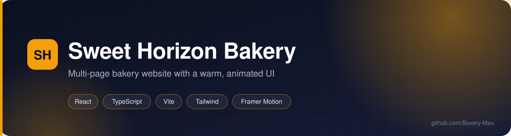
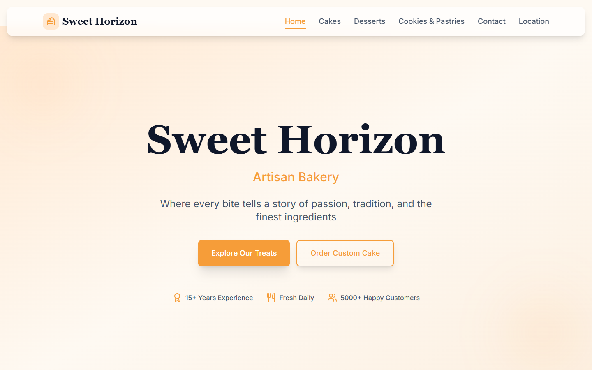

<div align="center">



<br/><br/>

<p><b>A multi-page bakery website with a warm palette and page-transition animations.</b></p>


<br/><br/>

<a href="https://bovery-max.github.io/PatisserieWebsite/"></a>

<p>
<a href="#-pages">Pages</a> ·
<a href="#-features">Features</a> ·
<a href="#-getting-started">Getting started</a> ·
<a href="#-project-structure">Structure</a>
</p>

</div>



## 📄 Pages

| Route | Page |
|---|---|
| `/` | Home |
| `/cakes` | Cakes |
| `/desserts` | Desserts |
| `/cookies-pastries` | Cookies & Pastries |
| `/contact` | Contact |
| `/location` | Location |

## ✨ Features

- 📱 Responsive layout for phone, tablet and desktop
- 🧭 Client-side routing with React Router
- 🎞️ Framer Motion page and element animations
- 🧩 Shared `Button` and `Card` components, Lucide icons
- ⚡ Vite dev server and production build

## 🚀 Getting started

Requires Node.js 18+.

```bash
git clone https://github.com/Bovery-Max/PatisserieWebsite.git
cd PatisserieWebsite
npm install
npm run dev        # http://localhost:5173
```

```bash
npm run build      # production bundle in dist/
npm run preview    # serve the build locally
```

## 🗂️ Project structure

```
src/
  components/
    Navigation.tsx
    Footer.tsx
    ui/              Button, Card
  pages/             Home, Cakes, Desserts, CookiesPastries, Contact, Location
  App.tsx            routes
  main.tsx
docs/                README images
index.html
vite.config.ts
tailwind.config.js
```

---

<div align="center">
<sub>Personal portfolio project · <a href="https://github.com/Bovery-Max">Emir Sanal</a> · <a href="https://www.linkedin.com/in/emir-sanal-12432b322/">LinkedIn</a></sub>
</div>
